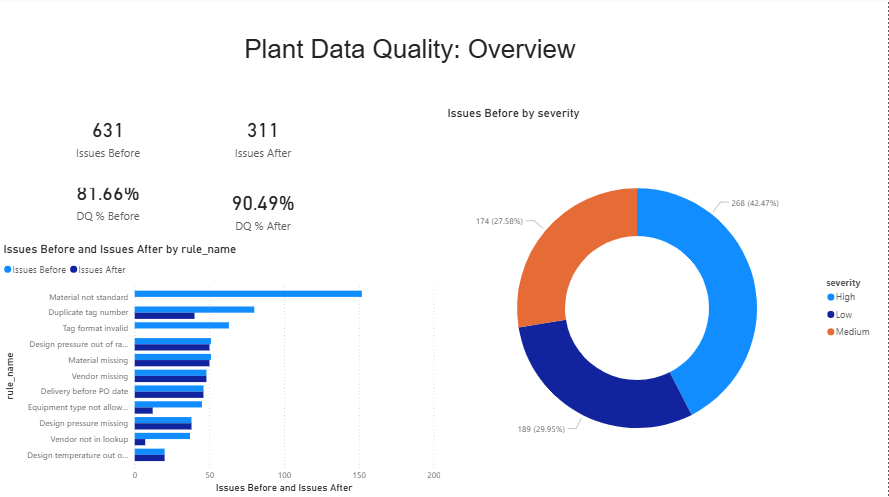
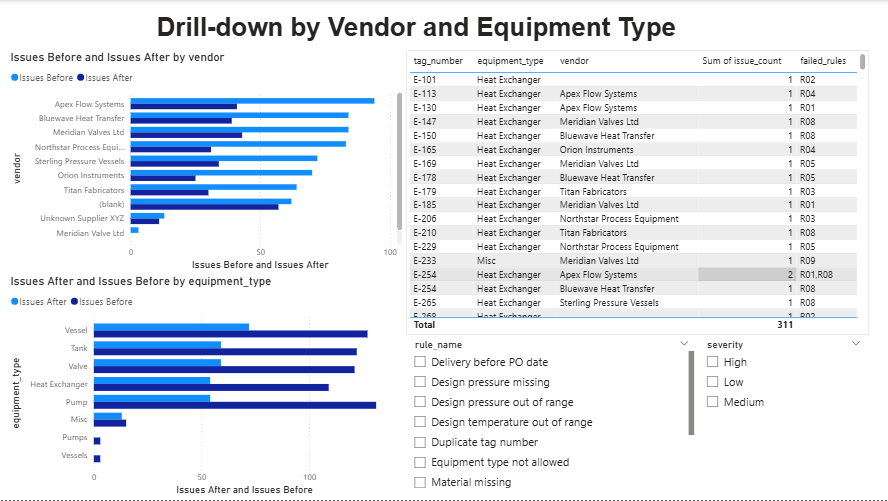

# Plant Equipment Data Quality & Validation

An end-to-end data management project: load a messy plant equipment list into MySQL, validate it with SQL rules,
clean what can be fixed safely with Python, and report data quality in Power BI.

> **Note:** the dataset is **synthetic**, generated by `01_generate_data.py` with deliberately injected errors. It is not real plant data.

## Results
| Metric | Before cleaning | After cleaning |
|---|---|---|
| Records | 3,080 | 3,040 (40 exact duplicates removed) |
| Records failing at least one rule | 565 | 289 |
| Data quality score | 81.66% | 90.49% |
| Total rule violations | 631 | 311 (about 51% fewer) |

The 289 records that still fail are not guessed or auto-filled. They are moved to `equipment_quarantine` for manual review
(missing values, out-of-range numbers, delivery before PO date, same tag with conflicting details, unknown vendor/type).

### Issues per rule (before / after)
| Rule | Description | Severity | Before | After |
|---|---|---|---|---|
| R01 | Duplicate tag number | High | 80 | 40 |
| R02 | Vendor missing | High | 48 | 48 |
| R03 | Material missing | High | 51 | 50 |
| R04 | Design pressure missing | High | 38 | 38 |
| R05 | Design pressure out of range | High | 51 | 50 |
| R06 | Design temperature out of range | Medium | 20 | 20 |
| R07 | Tag format invalid | Medium | 63 | 0 |
| R08 | Delivery date before PO date | Medium | 46 | 46 |
| R09 | Equipment type not in lookup | Medium | 45 | 12 |
| R10 | Material not in lookup | Low | 152 | 0 |
| R11 | Vendor not in lookup | Low | 37 | 7 |

Rule counts closely match what was injected (see `injected_errors.csv`). Small differences come from duplicate rows that copied an already-faulty record.

## Dashboard



## Pipeline
1. `01_generate_data.py` creates `equipment_raw.csv` (3,080 rows) and `injected_errors.csv`.
2. `02_schema.sql` creates the database: lookup tables (vendor, equipment_type, material), staging table, validation tables, and the normalized `equipment` table.
3. `03_load_data.sql` loads the raw rows into `stg_equipment` (`03_load_data.py` is an alternative using pandas).
4. `04_validation_rules.sql` defines 11 rules and the stored procedure `sp_run_validation(run_label)`. Techniques used: `ROW_NUMBER()` window function for duplicates, `REGEXP_LIKE` for tag format, joins/`NOT EXISTS` against lookup tables, date and range checks.
5. `05_clean_data.py` (pandas) fixes tag format, spelling of type/material/vendor, and removes exact duplicate rows. It does not guess missing or wrong values.
6. `06_publish_clean_data.sql` moves passing records to `equipment` and failing ones to `equipment_quarantine`, and produces the before/after numbers.
7. `07_export_for_powerbi.py` exports CSVs to `powerbi_data/`; `Plant_DQ_Dashboard.pbix` is the report.

## How to run
Requires MySQL 8.0+, Python 3.9+ with `pandas sqlalchemy pymysql`.
```
python 01_generate_data.py
# MySQL Workbench: run 02_schema.sql, then 03_load_data.sql, then 04_validation_rules.sql
# then: CALL sp_run_validation('BEFORE');
set DB_URL=mysql+pymysql://root:<password>@localhost:3306/plant_dq
python 05_clean_data.py
# then: CALL sp_run_validation('AFTER');
# MySQL Workbench: run 06_publish_clean_data.sql
python 07_export_for_powerbi.py
```
Note: MySQL Workbench has safe update mode on by default; `04_validation_rules.sql` handles it.

## Power BI measures (DAX)
```
Total Records Raw = COUNTROWS(equipment_raw)
Total Records Clean = COUNTROWS(equipment_clean)
Failed Before = CALCULATE(DISTINCTCOUNT(issues[record_id]), issues[run_label] = "BEFORE")
Failed After = CALCULATE(DISTINCTCOUNT(issues[record_id]), issues[run_label] = "AFTER")
DQ % Before = DIVIDE([Total Records Raw] - [Failed Before], [Total Records Raw])
DQ % After = DIVIDE([Total Records Clean] - [Failed After], [Total Records Clean])
Issues Before = CALCULATE(COUNTROWS(issues), issues[run_label] = "BEFORE")
Issues After = CALCULATE(COUNTROWS(issues), issues[run_label] = "AFTER")
```

## Validation rules: design choices
- Fix only what is safe to fix automatically (formatting, known spelling variants, exact duplicates).
- Anything needing a human decision is quarantined, not guessed.
- Rules are stored in `validation_rules` with a severity, and every violation is logged in `validation_log` with a run label (BEFORE/AFTER), so quality can be compared over time.

## Limitations
- Synthetic data; real plant data would have more complex rules (instrument ranges per service, cross-discipline checks).
- Cleaning maps are hand-written for the known variants in this dataset.
